# Pustakanesia - Digital Library

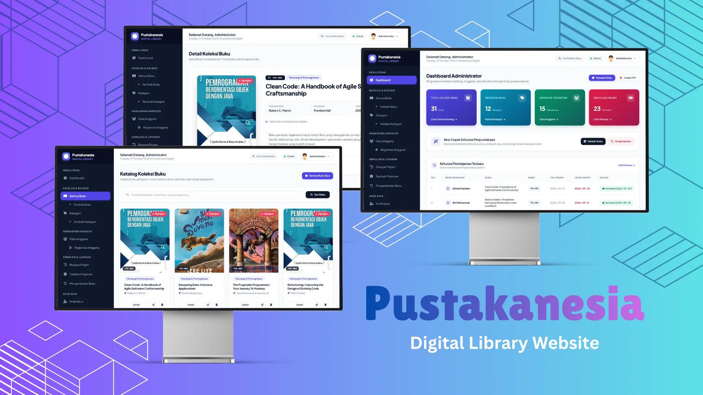


## Project Overview

Pustakanesia - Digital Library is a full-stack web-based library information and circulation management system built with Laravel and MySQL. It provides an integrated portal for library administrators and registered student members to manage book inventories, multi-category classifications, member profiles, and borrowing-and-return workflows. By replacing manual ledger tracking with transactional database operations, role-scoped interfaces, and automated PDF report generation, the application streamlines daily catalog discovery and physical book circulation monitoring.

## Key Features

- **Role-Scoped Dashboards**: Dedicated administrator dashboard displaying total books, categories, registered members, transaction counts, and recent loan activity, paired with a student reading room summarizing active personal loans and library borrowing policies.
- **Book Catalog Management & Search**: Paginated and searchable book catalog supporting cover image uploads, unique book codes, author/publisher metadata, stock availability tracking (`In Stock` vs. `dipinjam`), and many-to-many category assignment via Select2.
- **Category Classification Directory**: Full CRUD management for book genres and academic subjects (`kategori`) with live client-side filtering and category-filtered collection views.
- **Student Member Management**: Administrator CRUD workflows for student accounts (`users` and `profile` tables) capturing student identification numbers (`npm`), study programs (`prodi`), phone numbers, and addresses, alongside self-service registration.
- **Transactional Borrowing & Return Circulation**: Atomic database transactions (`DB::beginTransaction()`) that synchronize `riwayat_pinjam` records and `buku.status`, automatically assign a 7-day due date (`tanggal_wajib_kembali`), and enforce a maximum quota of 3 concurrent unreturned books per member.
- **PDF Circulation Report Export**: Server-side PDF generation powered by DomPDF (`CetakLaporanController`) compiling full borrowing histories into a downloadable `laporan_peminjaman.pdf` summary.
- **Account Profile & Avatar Management**: Self-service profile editing with unique `npm` validation, custom profile photo upload, and automatic cleanup of previous uploaded images.

## Tech Stack

| Category | Technology | Purpose |
| :--- | :--- | :--- |
| Backend Language | PHP | Server-side application logic and controller execution |
| Backend Framework | Laravel | MVC routing, Eloquent ORM, validation, authentication, and migrations |
| Database | MySQL | Relational persistence for users, profiles, books, categories, and loan records |
| Templating Engine | Blade | Server-rendered HTML views and reusable layout partials |
| Frontend Styling | Tailwind CSS & Bootstrap / Sass | Utility-first UI styling for application views and auth scaffolding |
| Interactive UI | JavaScript, jQuery & Select2 | Client-side table filtering, modal toggles, and multi-select category inputs |
| Notifications | SweetAlert2 (`realrashid/sweet-alert`) | Interactive feedback alerts for CRUD, borrowing, and return actions |
| PDF Generation | DomPDF (`barryvdh/laravel-dompdf`) | Rendering HTML circulation reports into downloadable PDF documents |
| Asset Bundling | Laravel Mix (Webpack) | Compiling Sass and JavaScript bundles into public assets |
| Dependency Management | Composer & npm | Managing PHP packages and frontend build dependencies |

## Application Architecture

Pustakanesia follows a monolithic Laravel MVC architecture where authenticated browser requests pass through session and `auth` middleware before reaching domain-specific controllers. Controllers interact with Eloquent models backed by MySQL, execute atomic transactions during circulation updates, store uploaded media in `public/images/`, and render Blade views or stream DomPDF documents back to the client.

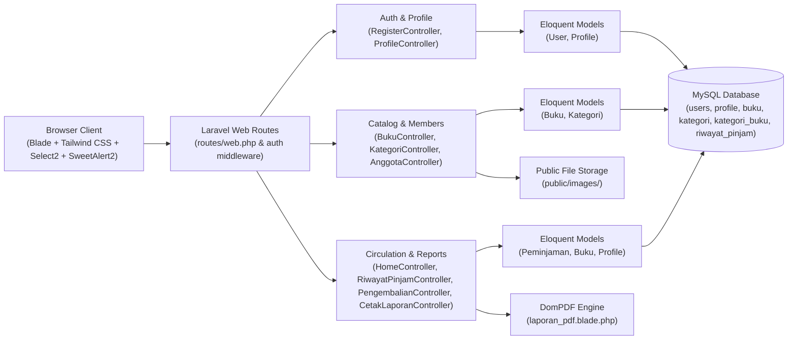

## Screenshots / Preview

### 1. Member & Admin Login Portal
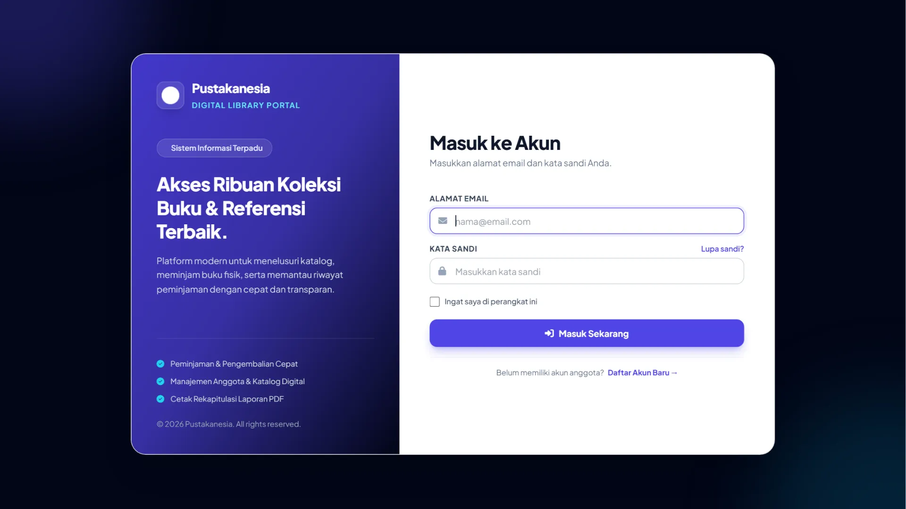
Split-screen authentication interface introducing Pustakanesia's digital library capabilities on the left panel while providing an email and password login form, password-reset link, remember-me toggle, and registration redirect on the right.

### 2. Student Member Registration Form
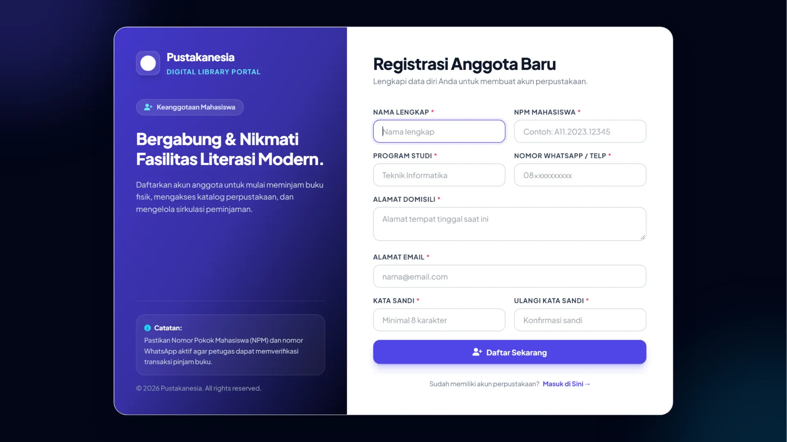
Self-service onboarding screen where prospective student members submit their full name, student ID (`NPM`), study program, WhatsApp/phone number, residential address, email, and password to create both a user account and a linked profile record.

### 3. Administrator Dashboard Overview
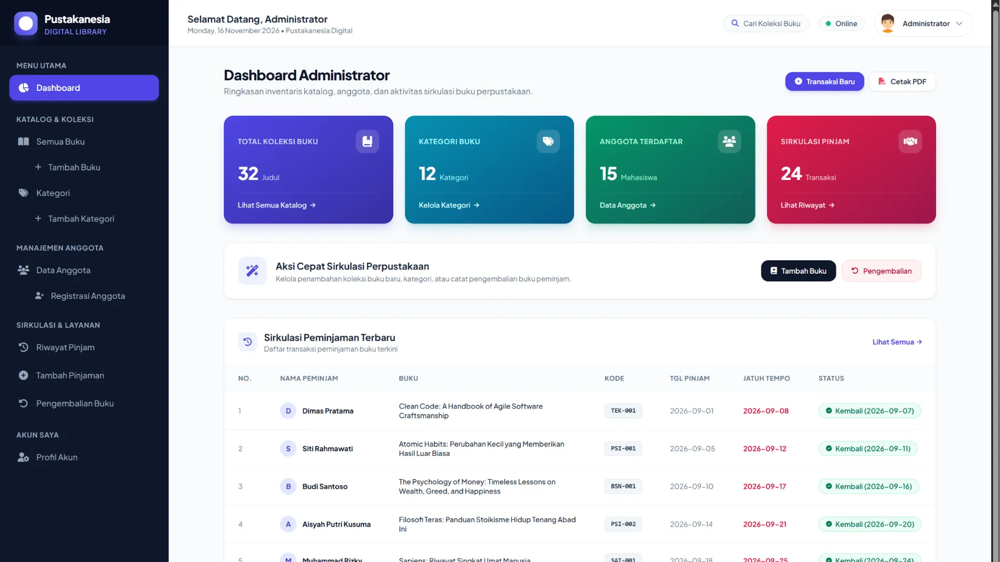
Central administrative workspace featuring four KPI summary cards (total books, categories, registered members, and circulation transactions), quick shortcuts for adding books or processing returns, and a live table of the latest borrowing activity.

### 4. Book Catalog Grid (Administrator View)
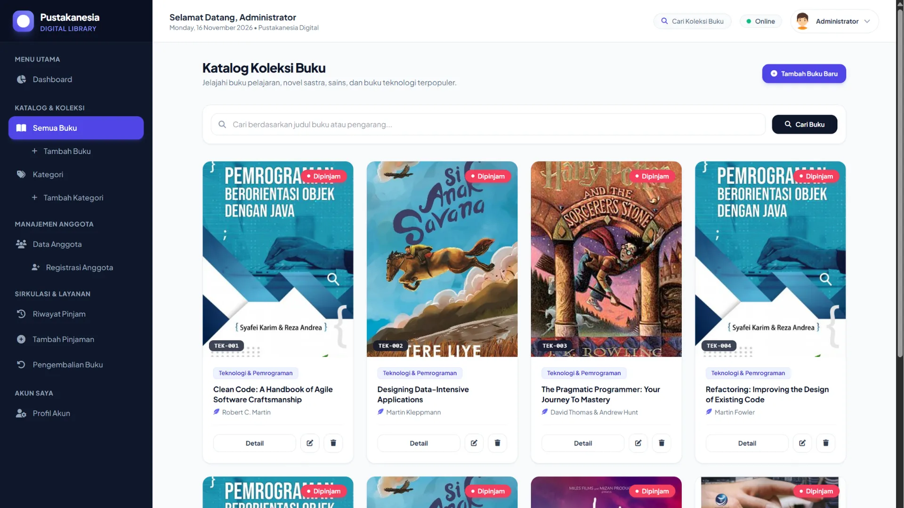
Paginated library catalog presenting book cover cards with unique catalog codes, category tags, current availability badges, a keyword search bar, and administrative actions to inspect details, edit records, delete titles, or add new books.

### 5. Book Categories Directory (Administrator View)
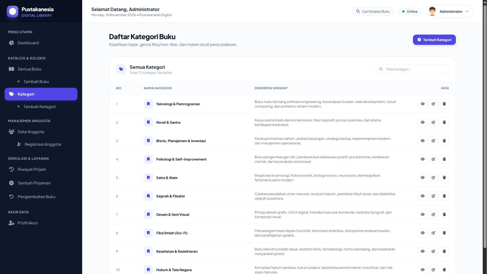
Structured category management table listing all registered genres and academic classifications alongside short descriptions, an instant client-side filter input, and buttons to view category books, edit metadata, or remove categories.

### 6. Registered Members Directory
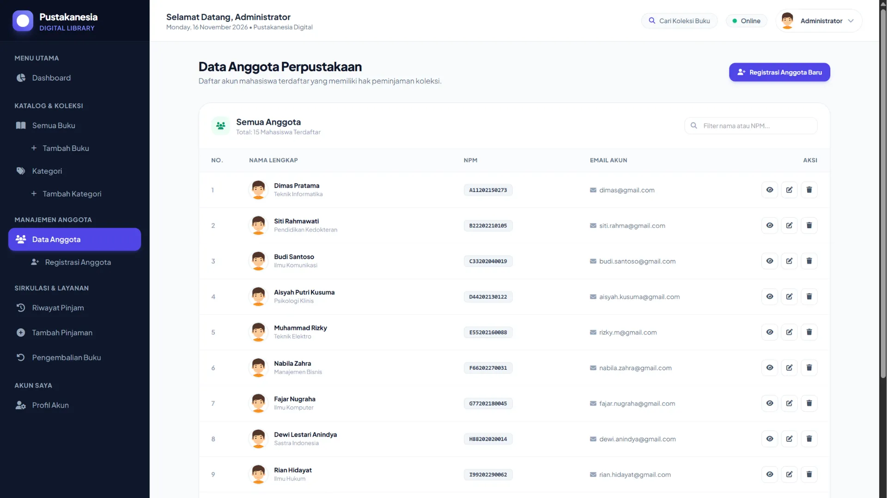
Administrative roster displaying registered student members with their study program, unique `NPM` identifier, and email address, equipped with live search filtering and quick actions to inspect borrowing history, edit profiles, or register new members.

### 7. Borrowing Circulation & History Log
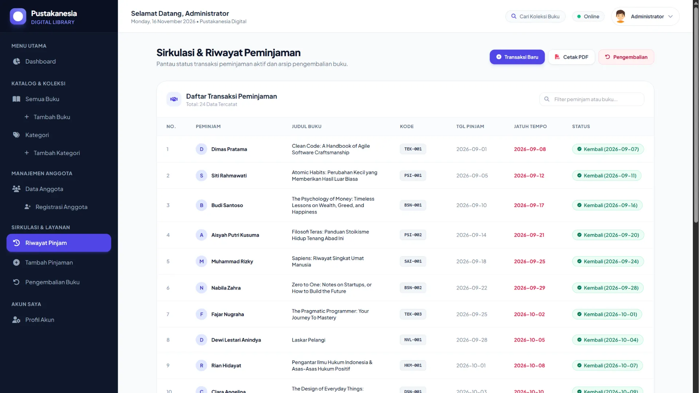
Comprehensive transaction ledger showing borrower avatars, book titles, book codes, borrow dates, 7-day due dates, and return status pills, complete with live filtering and action buttons for new loans, returns, and PDF report export.

### 8. Book Borrowing Form (Administrator View)
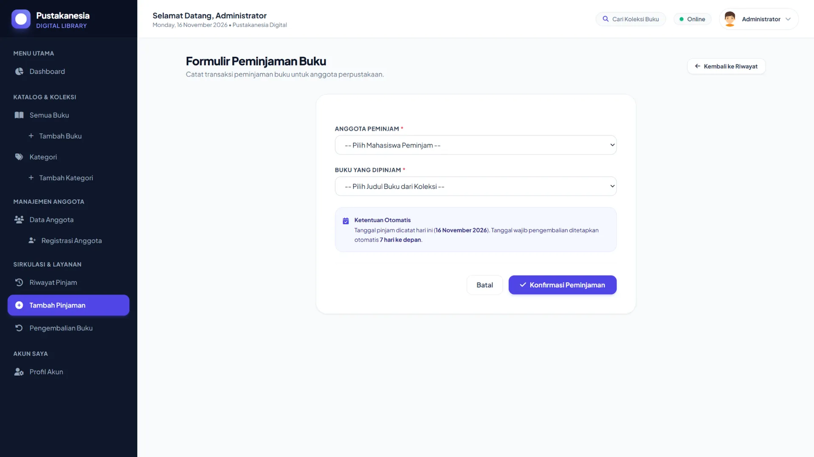
Transaction creation interface allowing administrators to pair an active student member with an `In Stock` book while displaying the automated 7-day return deadline notice prior to confirming the loan.

### 9. Book Return Processing Form
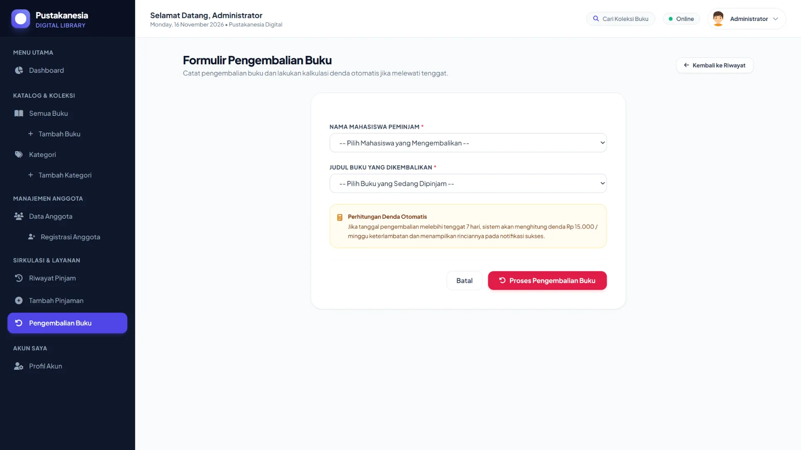
Return workflow interface where staff select a returning student and borrowed title to close an open loan record, restore book availability to `In Stock`, and review the displayed late-return fine policy notice (`Rp 15.000 / week` past the 7-day deadline).

### 10. Administrator Account Profile
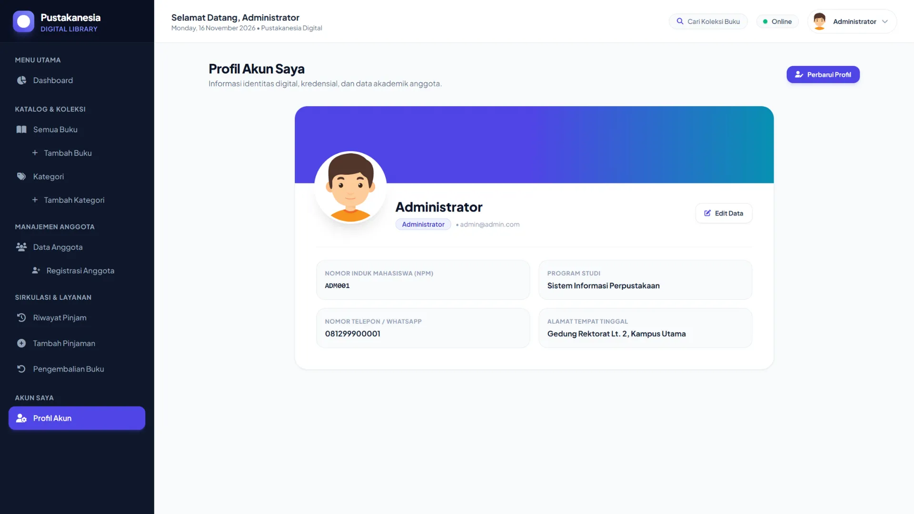
Account overview card displaying the administrator's avatar, role badge, email address, internal ID (`ADM001`), department, contact number, and campus office location with direct controls to update profile details.

### 11. Student Member Reading Room Dashboard
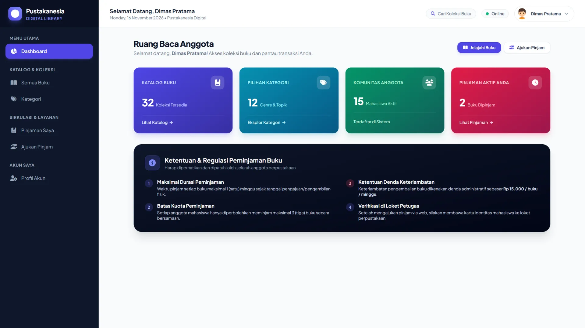
Personalized landing view for logged-in students summarizing available catalog collections, categories, active member community size, and personal active loans alongside a clear four-point guide covering loan duration, 3-book quota, late policy, and counter verification.

### 12. Book Catalog Grid (Student Member View)
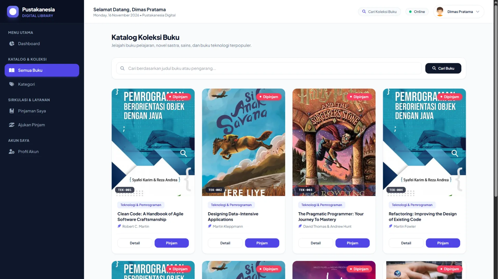
Student-facing catalog layout displaying searchable book cards with cover artwork, book codes, category labels, availability status badges, and direct `Detail` and `Pinjam` (Borrow) actions tailored for member self-service.

### 13. Book Categories Directory (Student Member View)
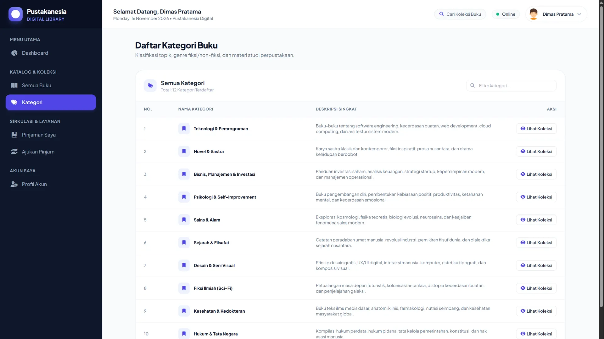
Read-only category exploration view enabling student members to filter genres by keyword and open curated book collections filtered by each subject classification.

### 14. Student Personal Loan History
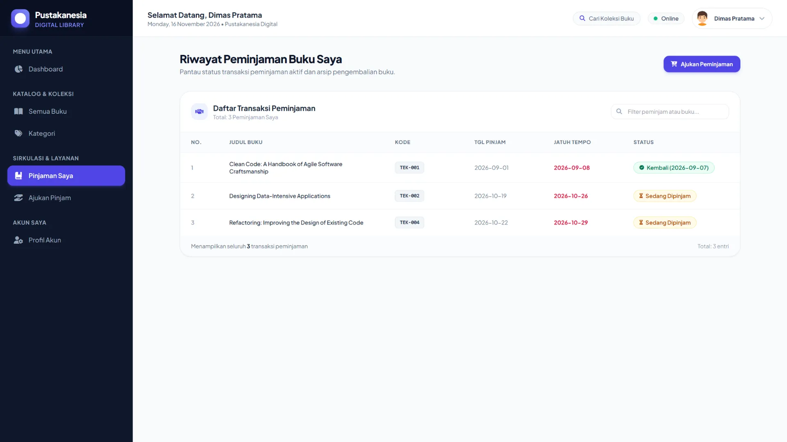
Member-scoped transaction log tracking the authenticated student's past returns and currently borrowed books, complete with borrow dates, due dates, status badges, live search, and a shortcut to request a new loan.

### 15. Student Book Loan Request Form
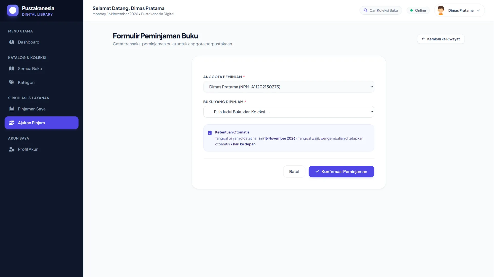
Streamlined borrowing form for student accounts with the borrower field pre-bound to the logged-in member's identity, restricting selection to available `In Stock` titles and showing the automatic 7-day return date calculation.

### 16. Student Member Account Profile
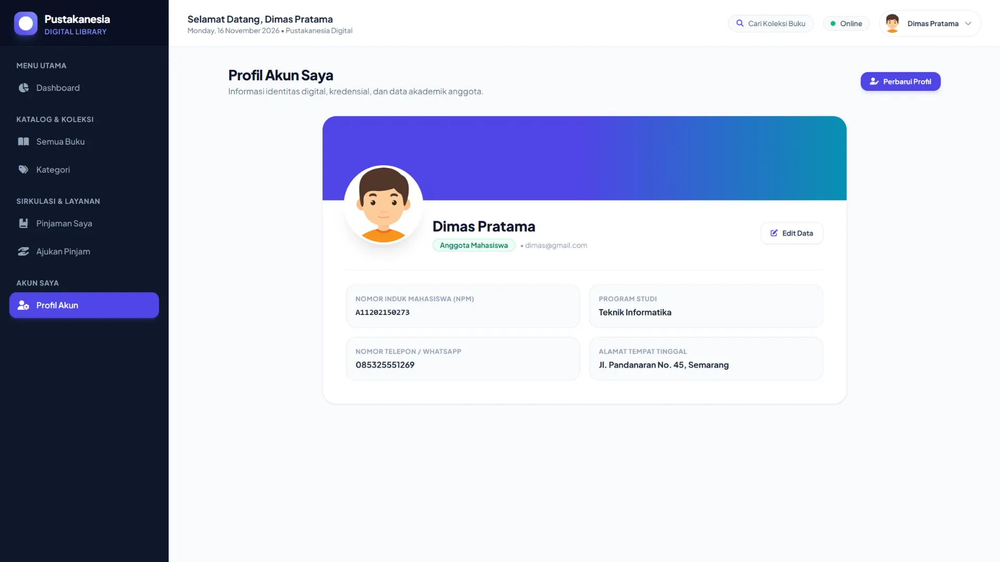
Personal identity card presenting the student's avatar, membership badge, email, `NPM`, study program, phone number, and residential address with an entry point to update account credentials and upload a new profile photo.

## Prerequisites

- **PHP** `^7.3` or `^8.0` with standard Laravel extensions (`pdo_mysql`, `mbstring`, `openssl`, `tokenizer`, `xml`, `ctype`, `json`, `gd` or `imagick` for DomPDF)
- **Composer** (PHP dependency manager)
- **Node.js & npm** (for compiling frontend assets with Laravel Mix)
- **MySQL** (relational database server)

## Installation & Setup

1. Clone the repository and enter the project directory:
   ```bash
   git clone https://github.com/weztcy/Pustakanesia-Digital-Library.git
   cd Pustakanesia-Digital-Library
   ```

2. Install PHP dependencies via Composer:
   ```bash
   composer install
   ```

3. Install frontend dependencies and compile assets with Laravel Mix:
   ```bash
   npm install
   npm run dev
   ```

4. Create your environment file from the example template and generate the application key:
   ```bash
   cp .env.example .env
   php artisan key:generate
   ```

5. Configure your MySQL connection in `.env` (see [Environment Variables](#environment-variables) and [Database Configuration](#database-configuration)), then run migrations and seed the sample library dataset:
   ```bash
   php artisan migrate --seed
   ```

## Usage

After installing dependencies and migrating the database, start the local Laravel development server and interact with the portal via your browser.

1. Launch the built-in PHP development server:
   ```bash
   php artisan serve
   ```

2. Open `http://127.0.0.1:8000` in your browser to reach the Pustakanesia login screen.
3. Sign in with an existing Administrator or Student Member account, or register a new student account via `/register`.
4. Use the sidebar navigation to browse the book catalog (`/buku`), filter categories (`/kategori`), submit or manage borrowing transactions (`/peminjaman`), process returns (`/pengembalian`), or download the PDF circulation report (`/cetaklaporan`).

## Environment Variables

Application runtime behavior, database connectivity, and session/cache drivers are configured through `.env` based on `.env.example`.

| Variable | Description | Example |
| :--- | :--- | :--- |
| `APP_NAME` | Display name of the application | `Laravel` |
| `APP_ENV` | Current execution environment | `local` |
| `APP_KEY` | Encryption key generated by `php artisan key:generate` | `base64:...` |
| `APP_DEBUG` | Enables detailed error debugging during development | `true` |
| `APP_URL` | Base URL used for routing and asset generation | `http://localhost` |
| `DB_CONNECTION` | Database driver used by Eloquent ORM | `mysql` |
| `DB_HOST` | Hostname or IP address of the MySQL server | `127.0.0.1` |
| `DB_PORT` | Port number for the MySQL service | `3306` |
| `DB_DATABASE` | Target schema name for Pustakanesia tables | `laravel` |
| `DB_USERNAME` | MySQL database username | `root` |
| `DB_PASSWORD` | MySQL database password | `your_db_password` |

```env
APP_NAME=Laravel
APP_ENV=local
APP_KEY=
APP_DEBUG=true
APP_URL=http://localhost

DB_CONNECTION=mysql
DB_HOST=127.0.0.1
DB_PORT=3306
DB_DATABASE=laravel
DB_USERNAME=root
DB_PASSWORD=
```

## Database Configuration

Pustakanesia uses MySQL with Laravel schema migrations (`database/migrations/`) defining `users`, `profile`, `kategori`, `buku`, `kategori_buku`, and `riwayat_pinjam` tables, plus `DatabaseSeeder` to populate 12 categories, 32 books, 15 student members, 1 administrator account, and 24 circulation records.

1. Create an empty MySQL database matching `DB_DATABASE` in your `.env` file.
2. Run all database migrations and execute the database seeder:
   ```bash
   php artisan migrate --seed
   ```
3. To reset and re-seed the database cleanly during development:
   ```bash
   php artisan migrate:fresh --seed
   ```

## Authentication & Authorization

Authentication is implemented using `laravel/ui` session guards, protecting all library routes inside the `Route::middleware(['auth'])` group in `routes/web.php`, while role-based authorization is enforced via the `users.isAdmin` boolean flag.

- **Session Authentication**: Unauthenticated visitors at `/` are served `auth.login`, and registration via `RegisterController` hashes passwords with `Hash::make()` while creating linked `User` and `Profile` records.
- **Administrator Role (`isAdmin == 1`)**: Gains access to `AdminDashboard`, book and category creation/editing/deletion, student member CRUD (`AnggotaController`), full borrowing history across all members, return processing (`PengembalianController`), and PDF report export (`CetakLaporanController`).
- **Student Member Role (`isAdmin == 0`)**: Directed to `AnggotaDashboard`, restricted to browsing books and categories, viewing personal loan records, submitting loan requests bound to their own profile, and updating their personal profile.

## Contributing

Contributions are welcome to enhance Pustakanesia - Digital Library. Follow the workflow below to propose changes cleanly:

1. Fork the repository.
2. Create a branch for the change.
3. Make and test the changes.
4. Commit and push the branch.
5. Open a pull request with a clear explanation.

## License

This project is licensed under the MIT License.
See the [LICENSE](LICENSE) file for details.

## Author & Contact

**Yohanes Dimas Pratama**

- GitHub: [github.com/weztcy](https://github.com/weztcy)
- Portfolio: [yohanesdimas.com](https://yohanesdimas.com)
- LinkedIn: [linkedin.com/in/yohanes-dimas](https://www.linkedin.com/in/yohanes-dimas)
